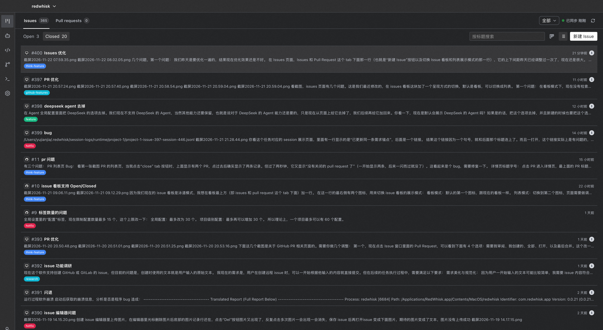
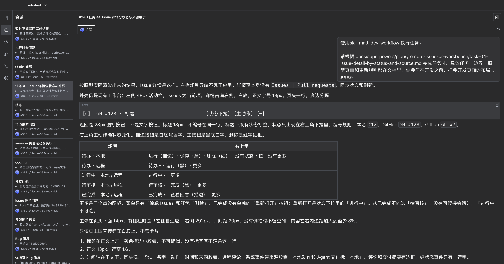
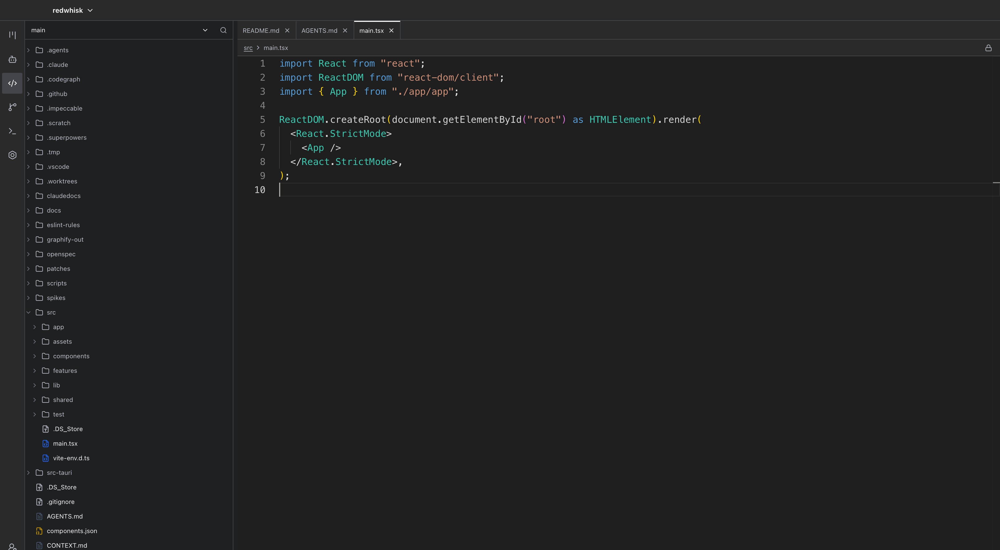
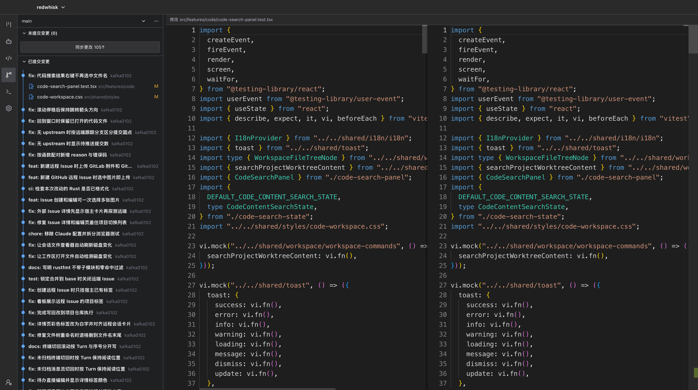

# RedWhisk

> **项目提示**
> 本项目主要用于学习和技术参考，不建议用于正式开发、团队协作或关键生产环境。当前 macOS 安装包没有通过 Apple 开发者账号签名和公证，覆盖安装新版本后，系统可能再次提示权限或安全校验问题。项目仍在持续迭代，功能、数据结构和工作流都可能变化，升级前请备份重要数据。

RedWhisk（红拂）是一款以 Issue 为核心的本地 AI Coding 工作台。它把 Git 仓库中的 Issue、Agent 会话、代码查看、变更检查和 Git 收尾放在同一个桌面应用中，并通过 Git Worktree 隔离不同开发任务。

## 功能介绍

| 能力 | 说明 |
| --- | --- |
| Issue 工作流 | 使用「待办 / 进行中 / 待审核 / 已完成」看板管理任务；支持本地 Issue、GitHub/GitLab Issue 镜像、来源筛选、标签、附件、评论与事件时间轴。远程 Issue 默认只读，应用内可显式关闭、回写交付摘要或创建 PR/MR。 |
| Agent 会话 | 可从 Issue 启动 Agent，查看结构化消息流、工具调用、子 Agent 输出和权限确认；支持模型选择、运行中追加或排队消息、停止、重开与续接，并提供会话通知、Token 用量和执行时长。可配置 Codex、Claude Code、OpenCode、Grok、DeepSeek。 |
| Worktree 隔离 | 每个 Issue 可使用独立 Worktree 和分支并行执行，避免多个 Agent 同时修改同一工作区。支持 Worktree 初始化命令、未提交改动检测、自动提交或跳过、合并到目标分支、创建 PR/MR 以及清理托管 Worktree。 |
| 代码与变更 | 代码页提供文件树、内容搜索、文件编辑与保存、TS/JS 诊断和定义/引用跳转，并支持 Markdown、Mermaid、图片和 PDF 预览。变更页提供未提交改动、提交历史、文件 diff、分支签出/创建/合并，以及安全的拉取、推送和同步。 |
| PR/MR 工作台 | 在应用内浏览 Pull Request / Merge Request 列表和详情，查看变更、检查、讨论与关联 Issue；满足宿主规则时可执行标记就绪、请求审阅、关闭和合并。 |
| 项目终端 | 可为项目创建多个交互式终端，保存启动命令和快捷命令；切换页面时保留终端会话，适合同时运行开发服务、测试和 Git 命令。 |
| 配置与数据 | 支持项目和全局 Agent 配置、工作流技能、项目标签、远程 Issue 同步与写回设置、中英文界面、深浅主题和版本提醒。业务状态保存在本机 SQLite 中，GitHub/GitLab 同步为可选能力。 |

RedWhisk 负责组织和编排本地工具，不内置模型账号。使用 Agent 前需要先在终端安装并登录对应的 Coding CLI；使用 GitHub/GitLab Issue 或 PR/MR 功能前，需要安装并登录 `gh` 或 `glab`。

## 系统支持

当前主要支持 macOS，GitHub Releases 提供的 Universal 安装包同时支持 Apple Silicon（aarch64）和 Intel（x86_64）。

## 安装

### 直接下载

请到 [GitHub Releases](https://github.com/kafka0102/redwhisk/releases) 下载最新版本。Release 附件提供：

- **DMG**（推荐）：`RedWhisk_<version>_universal.dmg`
- **`.app.zip`**：解压后将 `RedWhisk.app` 拖入「应用程序」

### 使用 DMG 安装

1. 打开下载的 `RedWhisk_<version>_universal.dmg`
2. 将 `RedWhisk.app` 拖入「应用程序」
3. 在「应用程序」中启动 RedWhisk

### 首次打开被 macOS 拦截

安装包未签名、未公证时，Gatekeeper 可能阻止首次启动。这不是安装包损坏。可以依次尝试：

1. 在 Finder 中右键 `RedWhisk.app`，选择「打开」，再确认一次。
2. 打开「系统设置」→「隐私与安全性」，找到被阻止的 RedWhisk，点击「仍要打开」。
3. 如果提示「已损坏，无法打开」，在终端清除隔离属性：

```bash
xattr -dr com.apple.quarantine /Applications/RedWhisk.app
```

### 升级

应用内的版本提醒只负责发现新版本并打开 Release 页面，不会自动安装。升级时需要先退出 RedWhisk，再用新下载的 `RedWhisk.app` 覆盖「应用程序」中的旧版本。

由于新版本仍未签名和公证，覆盖安装后 macOS 可能再次要求放行。升级前建议备份 `~/.redwhisk` 目录，其中包含本地数据库、日志和 Agent session 记录。

## 从源码本地打包

### 环境准备

本地构建需要：

- macOS
- Xcode Command Line Tools
- Node.js 22 和 pnpm 10
- Rust stable 工具链
- Git

Xcode Command Line Tools 可通过下面的命令安装：

```bash
xcode-select --install
```

Node.js 安装完成后，可以安装 pnpm：

```bash
npm install -g pnpm@10.32.1
```

Rust 请通过 [rustup](https://rustup.rs/) 安装，并确认 `rustup`、`cargo` 和 `pnpm` 在终端中可用。

### 本地开发

```bash
pnpm install --frozen-lockfile
pnpm tauri dev
```

### 构建 macOS 安装包

推荐使用仓库内置的 Universal 打包命令：

```bash
pnpm build:macos
```

该命令会安装两个 macOS Rust target，构建同时支持 Apple Silicon 和 Intel 的 `.app`，再生成 DMG。首次构建需要编译两份 Rust 产物，通常耗时 15–25 分钟。

产物位于：

```text
src-tauri/target/universal-apple-darwin/release/bundle/macos/RedWhisk.app
src-tauri/target/universal-apple-darwin/release/bundle/dmg/RedWhisk_<version>_universal.dmg
```

构建完成后可打开 DMG，将 `RedWhisk.app` 拖入「应用程序」。如果当前用户没有写入权限，可以使用管理员权限安装：

```bash
sudo cp -R src-tauri/target/universal-apple-darwin/release/bundle/macos/RedWhisk.app /Applications/
```

日常 `pnpm tauri build` 默认只生成 `.app`。需要可分发安装包时，请使用 `pnpm build:macos`。完整发版流程和签名限制见 [发布与打包规范](docs/standards/release-workflow.md)。

## 界面展示

### Issue 看板

看板集中展示本地与远程 Issue，支持按状态分栏、查看来源、标签、关联 PR/MR 和同步状态。点击卡片可以进入 Issue 详情，启动 Agent，或查看已有会话和交付结果。



### Agent 会话

Agent 会话保留 Issue 上下文、任务说明、工具调用和最终交付内容。右侧可以查看关联 Issue、会话信息和文件变更，便于在执行过程中核对结果。



### 代码工作区

代码工作区提供文件树、代码搜索、多文件标签页和编辑器。可以按文件进入轻量编辑模式，也能查看 Markdown、Mermaid、图片和 PDF 内容。



### 变更与 Git 管理

变更页集中展示未提交文件和提交历史，可以查看单文件 diff、提交详情和变更摘要，并完成分支签出、创建、合并、拉取、推送和同步。


