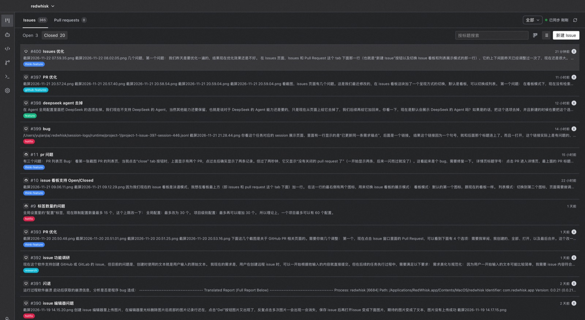
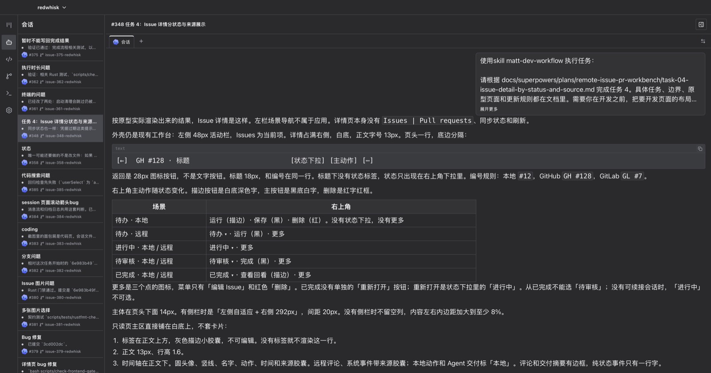
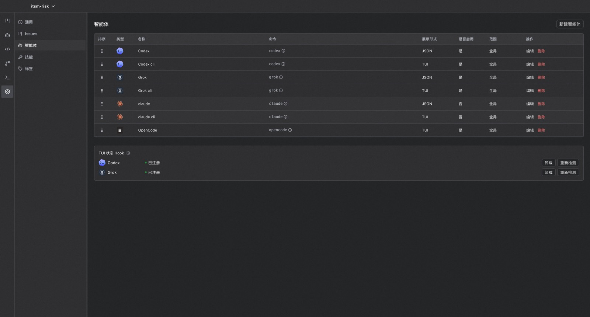
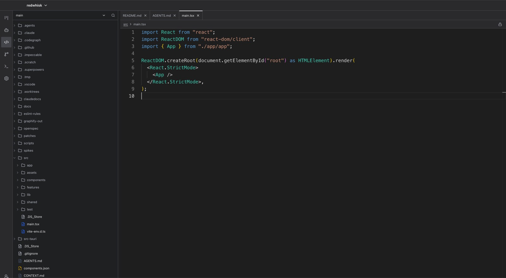
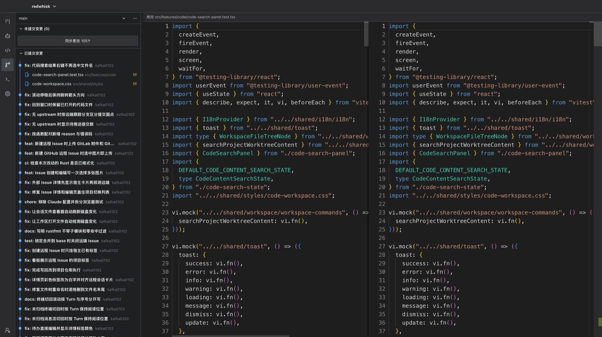
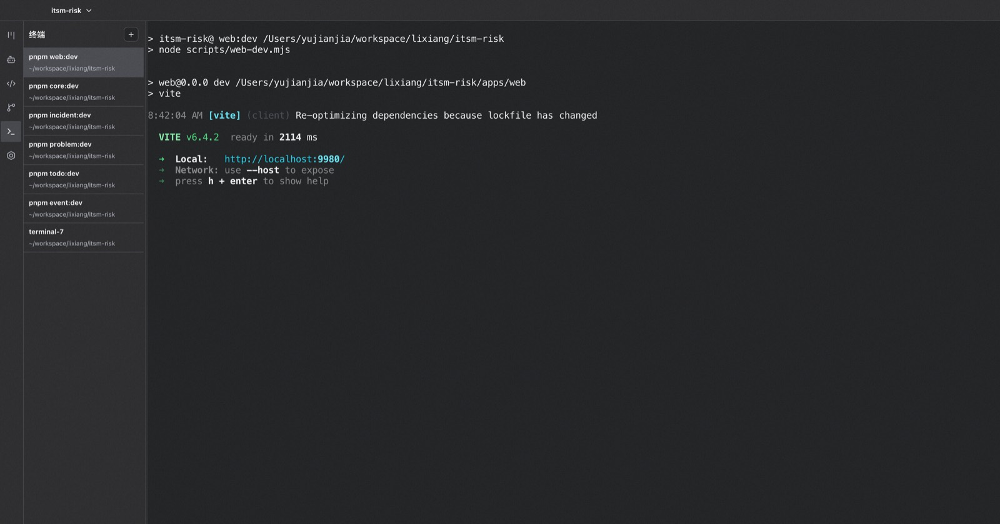

# RedWhisk

> **项目提示**
>
> 本项目主要用于学习和技术参考，不建议用于正式开发、团队协作或关键生产环境。当前 macOS 安装包未签名、未公证，覆盖升级后系统可能再次要求放行。项目仍在持续迭代，功能、数据结构和工作流都可能变化，升级前请备份重要数据。

RedWhisk（红拂）是一款以 Issue 为核心的本地 AI Coding 工作台。它把本地与远程 Issue、Agent 会话、代码查看、变更检查、PR/MR 审阅和项目终端收进同一个桌面窗口，并用 Git Worktree 隔离并行任务。

RedWhisk 负责组织和编排本地工具，不内置模型账号。Agent 使用本机已安装并登录的 Coding CLI；GitHub/GitLab 能力分别依赖 `gh` 和 `glab`。业务状态保存在本机 SQLite，远程平台只作为同步来源。

## 为什么使用 RedWhisk

- **少切换**：从 Issue 启动 Agent 后，可以在同一窗口核对代码、diff 和终端输出，不必反复重建上下文。
- **可并行**：每个 Issue 可以使用独立 Worktree 和分支，多个 Agent 不会同时修改同一份工作目录。
- **有留痕**：Issue 状态、评论、会话过程、交付摘要和关联 PR/MR 串在一起，后续查找结果时不必只依赖聊天记录。
- **先澄清再开发**：可以把澄清、拆解、开发、审查等步骤配置成工作流技能，并从 Issue 直接运行。

## 典型流程

1. 在 Issue 看板中创建本地 Issue，或同步 GitHub/GitLab Issue，并按「待办 → 进行中 → 待验收 → 已完成」推进。
2. 从 Issue 启动 Agent，选择模型和工作流技能；运行中可以查看工具调用、追加或排队消息，也可以停止和续接。
3. 在代码、变更和终端页面核对实现与运行结果，确认后把 Issue 标记为待验收。
4. 完成时按项目设置合并到目标分支或创建 PR/MR；远程 Issue 可按设置关闭并回写交付摘要，托管 Worktree 可随后清理。

## 功能能力

| 能力          | 说明                                                                                                                                                                                                                |
| ------------- | ------------------------------------------------------------------------------------------------------------------------------------------------------------------------------------------------------------------- |
| Issue 工作流  | 使用「待办 / 进行中 / 待验收 / 已完成」看板管理任务；支持本地 Issue、GitHub/GitLab Issue 镜像、来源筛选、标签、附件、评论与事件时间轴。远程 Issue 默认只读，可显式关闭、回写交付摘要或创建 PR/MR。                  |
| Agent 会话    | 可从 Issue 启动 Agent，查看结构化消息流、工具调用、子 Agent 输出和权限确认；支持模型选择、运行中追加或排队消息、停止、重开与续接，并提供会话通知、Token 用量和执行时长。可配置 Codex、Claude Code、OpenCode、Grok。 |
| 工作流技能    | 可按 Agent 类型配置项目或全局工作流技能，并在 Issue 运行时选用，把澄清、拆解、开发与审查步骤固化为可复用流程。                                                                                                      |
| Worktree 隔离 | 每个 Issue 可使用独立 Worktree 和分支并行执行；支持 Worktree 初始化命令、未提交改动检测、自动提交或跳过、合并到目标分支、创建 PR/MR 以及清理托管 Worktree。                                                         |
| 代码与变更    | 代码页提供文件树、内容搜索、文件编辑与保存、TS/JS 诊断和定义/引用跳转，并支持 Markdown、Mermaid、图片和 PDF 预览。变更页提供未提交改动、提交历史、文件 diff、分支签出/创建/合并，以及安全的拉取、推送和同步。       |
| PR/MR 工作台  | 在应用内浏览 Pull Request / Merge Request 列表和详情，查看变更、检查、讨论与关联 Issue；满足宿主规则时可执行标记就绪、请求审阅、关闭和合并。                                                                        |
| 项目终端      | 可为项目创建多个交互式终端，保存启动命令和快捷命令；切换页面时保留终端会话，适合同时运行开发服务、测试和 Git 命令。                                                                                                 |
| 配置与数据    | 支持项目和全局 Agent 配置、项目标签、远程 Issue 同步与写回设置、中英文界面、深浅主题和版本提醒。业务状态保存在本机 SQLite 中。                                                                                      |

## 系统支持

当前主要支持 macOS，GitHub Releases 提供的 Universal 安装包同时支持 Apple Silicon（aarch64）和 Intel（x86_64）。

## 安装

1. 从 [GitHub Releases](https://github.com/kafka0102/redwhisk/releases) 下载最新的 `RedWhisk_<version>_universal.dmg`。
2. 打开 DMG，将 `RedWhisk.app` 拖入「应用程序」。
3. 在「应用程序」中启动 RedWhisk。也可以下载 `.app.zip`，解压后把 `RedWhisk.app` 放入「应用程序」。

安装包未签名、未公证时，macOS 可能阻止首次启动。这不是安装包损坏：

- 在 Finder 中右键 `RedWhisk.app`，选择「打开」；或在「系统设置 → 隐私与安全性」中允许打开。
- 如果提示「已损坏，无法打开」，执行：

```bash
xattr -dr com.apple.quarantine /Applications/RedWhisk.app
```

升级时先退出 RedWhisk，再用新版本的 `RedWhisk.app` 覆盖旧版本。由于仍未签名、未公证，覆盖后可能需要再次放行。升级前建议备份 `~/.redwhisk`，其中包含本地数据库、日志和 Agent session 记录。

## 从源码运行与构建

需要 macOS、Xcode Command Line Tools、Node.js 22、pnpm 10、Rust stable 和 Git。

```bash
xcode-select --install
npm install -g pnpm@10.32.1
pnpm install --frozen-lockfile
pnpm tauri dev
```

构建同时支持 Apple Silicon 和 Intel 的 DMG：

```bash
pnpm build:macos
```

产物位于 `src-tauri/target/universal-apple-darwin/release/bundle/`。日常 `pnpm tauri build` 只生成当前目标平台的 `.app`。完整发布流程见 [发布与打包规范](docs/standards/release-workflow.md)。

## 界面展示

点击任一缩略图可查看原图。

|                                                                              Issue 看板                                                                              |                                                                             Agent 会话                                                                             |                                                                            智能体                                                                             |
| :------------------------------------------------------------------------------------------------------------------------------------------------------------------: | :----------------------------------------------------------------------------------------------------------------------------------------------------------------: | :-----------------------------------------------------------------------------------------------------------------------------------------------------------: |
| **Issue 看板**<br>[](./docs/screenshots/issue.png)<br>本地与 GitHub/GitLab Issue 统一看板 | **Agent 会话**<br>[](./docs/screenshots/session.png)<br>查看过程、工具调用和交付内容  |  **智能体**<br>[](./docs/screenshots/agents.png)<br>使用本机已登录的 Coding CLI   |
|        **代码工作区**<br>[](./docs/screenshots/code.png)<br>文件树、搜索和轻量编辑         | **变更与 Git**<br>[](./docs/screenshots/branch.png)<br>查看未提交改动、提交历史和 diff | **项目终端**<br>[](./docs/screenshots/terminal.png)<br>保留项目启动命令和终端会话 |

## 相关资源

- [Skills](https://github.com/kafka0102/skills)：可复用的本地开发工作流技能。
- [OneSpec](https://github.com/kafka0102/onespec)：较早的完整规格与 TDD 工作流方案。
